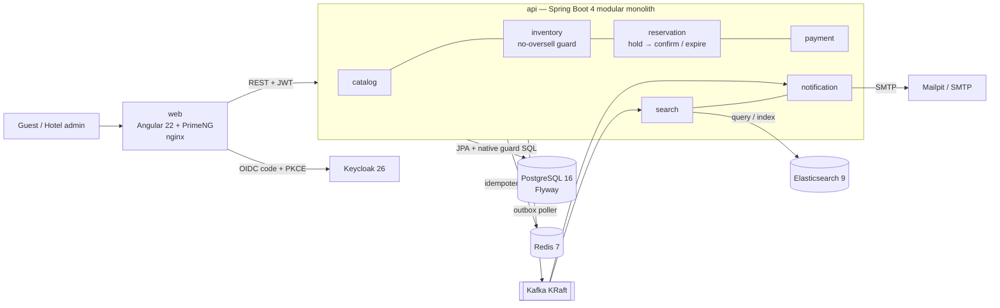

# Nuzul · نزول

[](https://github.com/rhorba/nuzul/actions/workflows/ci.yml)
[](https://sonarcloud.io/summary/new_code?id=rhorba_nuzul)
[](https://sonarcloud.io/summary/new_code?id=rhorba_nuzul)

Hotel reservations for Moroccan cities (Marrakech, Fès, Chefchaouen, Essaouira, Agadir, Tanger) whose core promise is
**zero double bookings under concurrency** — a conditional `UPDATE` under the row lock plus a `CHECK (reserved <= total)`
constraint, proven by named concurrency tests.

## Architecture



Modules follow Spring Modulith boundaries (verified by `ModularityTest`) and are hexagonal inside
(`domain` → `application` → `adapter`, enforced by ArchUnit). Design docs live in [`docs/`](docs/):
start with [`system-design-nuzul.md`](docs/system-design-nuzul.md).

## Run locally

Requirements: JDK 21+, Node 22, Docker.

```bash
docker compose up -d                 # Postgres :5435, Redis, ES, Kafka, Keycloak :8180, Mailpit :8025
cd api && ./mvnw spring-boot:run     # http://localhost:8080 · /swagger-ui.html · /actuator/health
cd web && npm ci && npm start        # http://localhost:4200
```

Demo users (realm `nuzul`, local only): `guest@nuzul.local` / `guest`, `admin@nuzul.local` / `admin`.
Configuration is read from environment variables — see [`.env.example`](.env.example).

## Test

```bash
cd api && ./mvnw verify    # unit + architecture + Testcontainers; JaCoCo gate ≥ 80 % lines
cd web && npm run lint && npx ng test --watch=false
```

## CI

GitHub Actions on every push and PR: api `verify` → SonarCloud quality gate · web lint/test/build ·
images (Jib for api, unprivileged nginx for web) → Trivy (fails on fixable CRITICAL) → pushed to GHCR from `main`
for `amd64` + `arm64`.

## Stack

Java 21 · Spring Boot 4.1 · Spring Modulith 2 · PostgreSQL 16 + Flyway · Redis · Elasticsearch 9 · Kafka ·
Keycloak · Angular 22 + PrimeNG · Testcontainers · SonarCloud · Trivy · Jib · Helm on k3s · Terraform (AWS S3 + CloudFront).
